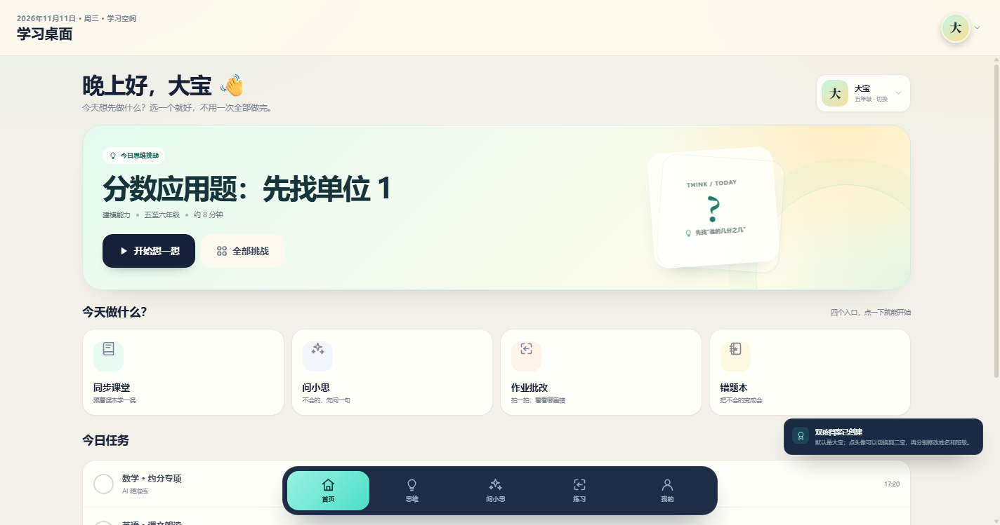
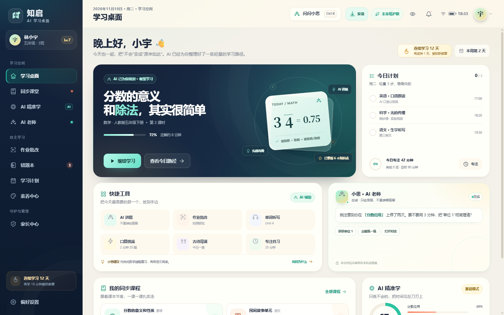
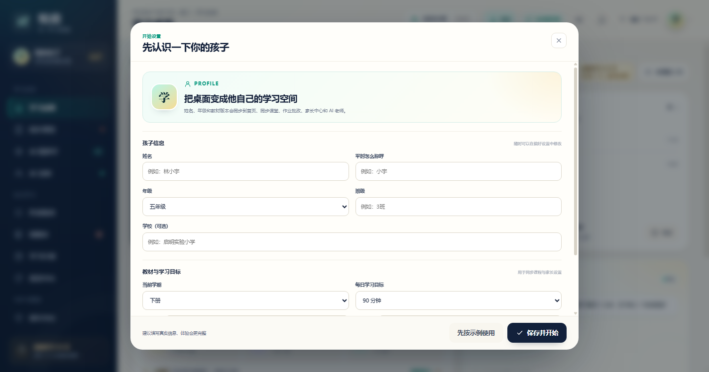
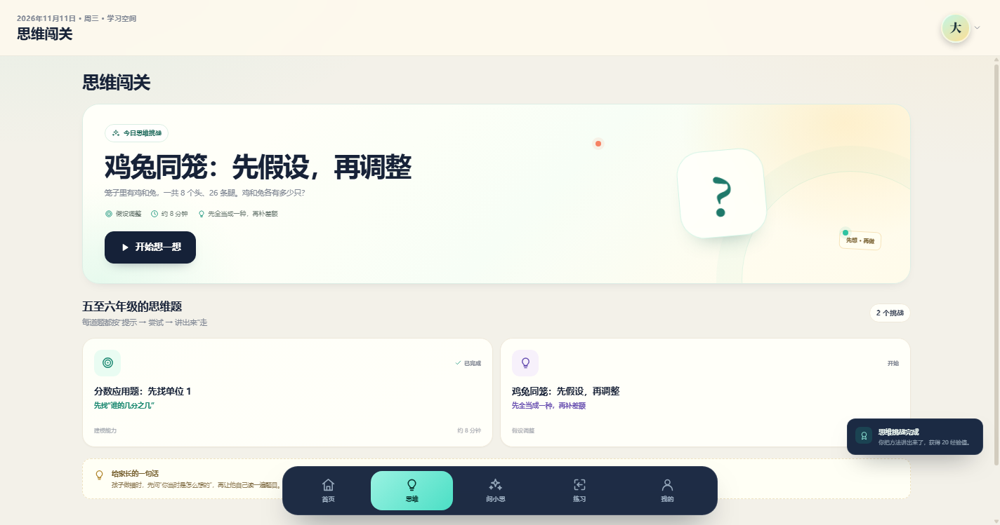
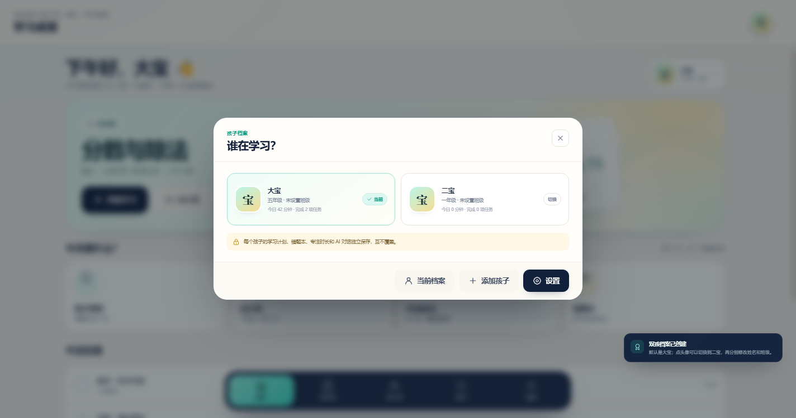

# 知启 · AI 学习桌面

一款对标学习机「一站式学习桌面」体验的浏览器应用：把同步课堂、AI 精准学、AI 老师、作业批改、错题本、学习计划、素养中心和家长守护收进同一个桌面。

纯静态前端，无构建、无后端。支持 **iPad 主屏幕安装、触摸操作和离线打开**。

> **版本定位**：这是一个可以个人家庭日常使用的 **Beta 1.3**。儿童简洁界面、多孩子独立档案、计划、错题、专注计时、本地教材库、PWA 安装和本地持久化都可正常使用；AI 讲题、作业批改和课程内容仍是本地示例，不是完整商业课程产品。







## 第一次打开：设置孩子档案

首次打开会自动出现「先认识一下你的孩子」：

- 姓名、平时称呼、学校、班级
- 年级（一年级–六年级）
- 当前学期（上册 / 下册）
- 语文、数学、英语、科学各自的教材版本
- 每日学习目标（30 / 45 / 60 / 90 / 120 分钟）

保存后会同步到首页问候、侧栏、同步课堂教材、作业批改卷头、家长中心和 AI 老师。以后可以在 **偏好设置 → 学习档案与教材** 里随时修改。

如果家里有两个孩子，可以直接点第一次设置页里的 **「使用双孩预设」**：会一键创建五年级「大宝」和一年级「二宝」，语文人教版、数学北师大版、英语沪教版、科学待确定，每日目标分别为 90 / 45 分钟。创建后在顶部头像里改名即可。

> 当前内置课程库是**五年级示例**。选择其他年级后，姓名、年级和教材版本会立即生效，但课程内容仍会明确标注为“示例课程”，不会自动下载对应教材。

## 儿童简洁模式

默认开启，给孩子的界面只有：

- 一个大大的「今天建议」学习卡
- 四个大入口：同步课堂、问小思、作业批改、错题本
- 今日任务，大勾选框
- 更多：学习计划、专注计时、素养中心、口算、古诗、单词听写
- 固定在底部的大图标导航：首页、思维、问小思、练习、我的
- 首页主卡不是教材进度，而是当前年级的一道**思维挑战**

侧栏、复杂统计和次要按钮默认隐藏。家长可以在 **我的 → 设置 → 儿童简洁模式** 关闭，切换到完整学习桌面。

## 学而思式思维引导

新增独立的「思维闯关」：不按教材版本走，专门训练思考过程。

每道题固定四步：

1. **读懂**：先用自己的话说清楚题目；
2. **拆解**：找条件、画图、列式；
3. **验证**：回头检查，换一种方式验证；
4. **表达**：用“因为……所以……”讲出方法。

过程中不直接给答案：先让孩子尝试，卡住时给提示；答错可以重试；最后必须口述/写下一个方法，才算完成。完成的挑战会记录方法卡、反思和提示使用次数，家长中心可以看到。

内置示例包括：

- 低年级：排队问题、找规律
- 中年级：条件排除
- 高年级：分数单位 1、鸡兔同笼

内容不依赖教材版本，后续可以继续扩充；目前是原创示例，不是完整题库。



## 多孩子切换



- 打开左上角头像 / 侧栏孩子卡片 / 底部「我的」，进入「谁在学习？」。
- 点另一个孩子即可切换；每个孩子有独立的姓名、年级、教材版本、计划、错题、专注时长和 AI 对话。
- 点「添加孩子」可以新建档案；新孩子从空白学习记录开始，不会混入另一个孩子的数据。
- 所有数据保存在当前设备；切换不会上传任何信息。

## 教材与版权

不能随应用打包或批量下载 1–6 年级全套受版权保护的教材。应用提供了两条合法路径：

1. **官方平台**：在设置中打开「国家中小学智慧教育平台 → 教材」，自己登录后选择学段、学科、版本和年级查看。知启不会接收或保存平台账号密码，也不做模拟登录。
2. **本地导入**：把自己合法拥有的 PDF / 图片导入「我的教材库」，保存在本机离线查看。

详细说明见 [TEXTBOOKS.md](TEXTBOOKS.md)。

## 在线使用与 iPad 安装

部署到任意 HTTPS 静态托管后，在 iPad 上用 **Safari** 打开：

1. 等首页完整加载（首次会缓存应用）。
2. 点 Safari 顶部 **分享** 按钮。
3. 选择 **添加到主屏幕**。
4. 名称填「知启」，确认添加。
5. 以后从主屏幕图标启动，就是全屏独立窗口。

> 微信、抖音等内置浏览器不支持「添加到主屏幕」，请用 Safari。
>
> iOS 的安装版与 Safari 使用独立的存储容器，学习记录不会在两个容器间自动迁移。

安装后，应用壳、课程和工具会通过 Service Worker 缓存；断网后仍可打开。

长期免费部署推荐 GitHub Pages，完整步骤见 [GITHUB-PAGES.md](GITHUB-PAGES.md)。注意：GitHub / GitHub Pages 在中国大陆的直连质量不稳定，无法保证完全不需要 VPN；打不开时可换用国内静态托管。其他托管方式见 [DEPLOY.md](DEPLOY.md)。

## 本地运行

**方式一：本地在线版（推荐，支持 PWA）**

双击 `start-server.bat`，或执行：

```powershell
python serve.py --port 8080
```

打开 <http://127.0.0.1:8080>。localhost 属于安全上下文，可以注册 Service Worker，测试离线与安装效果。

**方式二：直接打开文件（仅预览）**

双击 `index.html` 或 `start.bat`。此方式没有本地服务器，因此不会注册 Service Worker；适合快速查看界面。

**局域网浏览**

```powershell
python serve.py --bind 0.0.0.0 --port 8080
```

iPad 与电脑在同一 Wi-Fi 时访问 `http://电脑IP:8080`。局域网 HTTP 能浏览，但完整的离线安装需要 HTTPS。

## 触摸与 iPad 适配

- 所有按钮、任务行、筛选项、表单和弹窗在触摸设备上使用更大的点击区域（主要操作不低于 44px）。
- 禁用点击高亮、双击缩放和悬停残留，触屏按下时有明确反馈。
- 支持 iPad 横竖屏、分屏宽度和手机尺寸；1024 宽度会自动收起侧栏为图标导航。
- 聊天输入在 iOS 上使用 16px 字号，避免聚焦时页面被强制放大。
- 作业批改支持 iPad 相机 / 照片图库选择文件。
- 语音朗读使用浏览器 `SpeechSynthesis`，是否可用取决于系统语音包。
- 独立 PWA 窗口使用 `safe-area-inset-*` 避开刘海和 Home Indicator。

## 功能地图

| 模块 | 可以做什么 |
| --- | --- |
| 儿童简洁模式 | 大卡片首页、四个大入口、大任务勾选、底部大图标导航，默认隐藏复杂面板 |
| 思维闯关 | 读懂 → 拆解 → 验证 → 表达，提示阶梯、答错重试、口述反思、方法卡 |
| 学习桌面 | 今日学习路径、连续学习、快捷工具、同步课程、精准学摘要、AI 小思建议 |
| 多孩子 | 添加、切换独立档案；每个孩子独立计划、错题、专注时长与对话 |
| 同步课堂 | 语文 / 数学 / 英语 / 科学切换，单元目录、课时状态、三步式课程（概念 → 例题 → 练习） |
| AI 精准学 | 知识点雷达、基础 / 标准 / 备考三种模式、5 题诊断、掌握度更新、专属提升路径 |
| AI 老师 | 启发式对话、提示阶梯、分数与一元一次方程识别、同类题、答案保护 |
| 作业批改 | 上传图片或使用示例作业、模拟扫描、逐题批注、错因分析、AI 作业过滤、加入错题本 |
| 错题本 | 学科 / 未掌握筛选、搜索、错因解析、重新作答、掌握状态更新、导出文本 |
| 学习计划 | 周视图、按天添加 / 删除 / 完成任务、25 / 45 / 60 分钟专注计时、跨页面悬浮计时器 |
| 素养中心 | AI 识万物、AI 读绘本、诗词大会、AI 口语分级练、科学实验、创意编程 |
| 家长中心 | 最近 7 天学习时长、每日时长上限、答案保护、护眼、应用守护、周报与导出 |
| 我的教材库 | 导入合法拥有的 PDF / 图片教材，保存在本机 IndexedDB 离线查看；提供官方平台入口 |
| 偏好设置 | 儿童简洁模式、护眼、学习档案与教材、教材库、安装到主屏幕、数据说明、重置 |

## 交互细节

- 多孩子档案、学习记录、计划、错题和对话默认写入 `localStorage`，刷新页面不会丢失；教材文件写入 IndexedDB。家长中心或偏好设置里可以一键重置。
- 切换孩子时会先保存当前孩子的数据，再加载目标孩子的数据；每个孩子的数据完全独立。
- 课时完成后会自动推进到下一课时；完成练习会获得经验值。
- 专注计时器离开「学习计划」页面后会缩成右下角悬浮胶囊，继续计时；结束后记录专注分钟。
- 作业批改使用本地示例结果模拟，但上传、扫描、批改、加入错题本的完整流程都可操作。
- AI 老师是内置规则引擎，覆盖分数、分数应用题、一元一次方程、四则运算、语文复述、英语 can 句型、科学影子实验等场景，并遵循「先提示、后引导」的原则。
- 快捷键：`Ctrl / Cmd + K` 打开 AI 老师，`Esc` 关闭弹窗，`Enter` 在对话中发送。

## 目录结构

```text
zhiqi-learning-pad/
├─ index.html
├─ manifest.webmanifest     # PWA 清单
├─ sw.js                    # 离线 Service Worker
├─ serve.py                 # 本地静态服务器（正确 MIME + 缓存头）
├─ start.bat                # 直接打开文件（仅预览）
├─ start-server.bat         # 启动 localhost 在线版
├─ preview.png
├─ preview-kids.png
├─ preview-onboarding.png
├─ preview-family.png
├─ preview-thinking.png
├─ README.md
├─ DEPLOY.md
├─ GITHUB-PAGES.md           # GitHub Pages 分步部署指南
├─ TEXTBOOKS.md              # 教材版权与合法导入说明
├─ .nojekyll                 # GitHub Pages 静态资源配置
├─ icons/                   # 主屏幕 / PWA 图标
└─ assets/
   ├─ css/
   │  ├─ styles.css          # 设计系统、桌面布局、页面样式
   │  ├─ styles-extra.css    # 弹窗、课程播放器、响应式
   │  ├─ touch-pwa.css       # 触摸目标、iPad 安全区、PWA UI
   │  ├─ kid-mode.css        # 儿童简洁首页与底部导航
   │  └─ thinking.css        # 思维闯关页面与引导弹窗
   └─ js/
      ├─ data.js             # 课程、题库、错题、计划等演示内容
      ├─ thinking.js         # 低/中/高年级原创思维挑战
      ├─ ai.js               # 小思本地启发式回复引擎
      └─ app.js              # 路由、状态、视图与交互
```

## 更新缓存

修改前端文件后，请把 `sw.js` 中的 `CACHE_VERSION` 改成新的版本号再部署，否则已经安装的设备可能继续使用旧缓存。

## 说明

这是一个可交互的前端原型，不是学而思官方产品，也不包含任何官方素材。为便于直接运行：

- 不依赖真实大模型、OCR 或云端服务，所有 AI 与批改结果均在浏览器本地模拟。
- 示例课程和题目面向五年级，仅用于演示产品体验；真实教学使用前请由教研老师审核。
- 数据保存在当前浏览器或已安装的 PWA 容器中，清除站点数据会同时清除学习记录。
